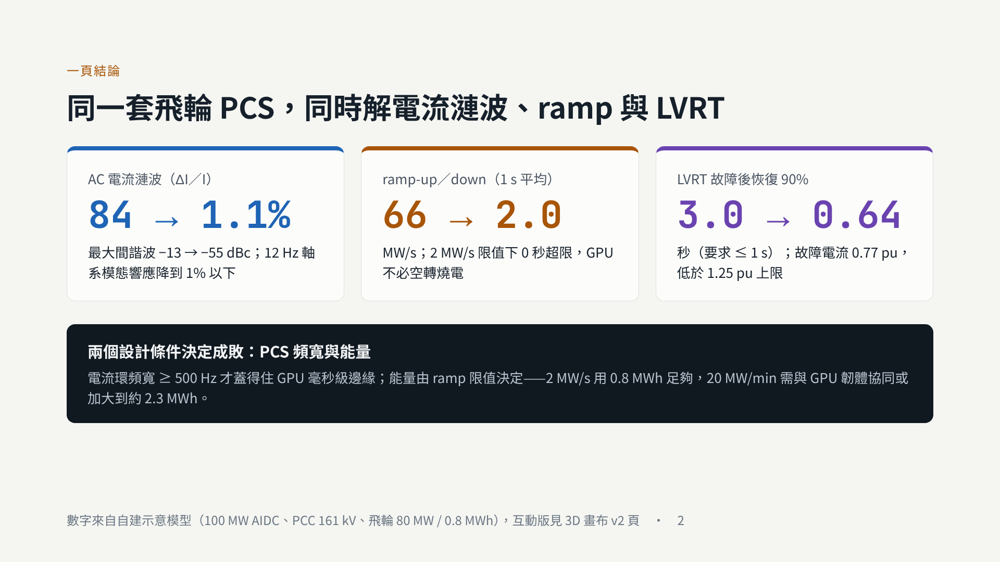

# Flywheel × AIDC：以飛輪儲能穩定 AI 資料中心動態負載

AI 訓練機房（AIDC）的用電不是一條平線：數萬張 GPU 在「計算 ↔ 通訊」之間同步切換，整座機房在 **35 ↔ 100 MW** 之間每秒來回一次，切換邊緣只有幾毫秒。這在電網端造成兩類問題：

1. **AC 電流漣波**：60 Hz 電流被調幅，在 60 ± k·f_iter 出現間諧波，落在區域振盪（0.5–5 Hz）與發電機軸系扭振（5–55 Hz）頻段。
2. **ramp 與 LVRT 合規**：作業啟停的 ramp 要慢（例：2 MW/s，最嚴 20 MW/min），但 ERCOT NOGRR282 要求故障清除後 1 秒內恢復 90% 用電、電流 ≤ 1.25 pu。

本專案提案以**設施級飛輪儲能**取代化學儲能：飛輪並聯在 PCC，作為雙向、毫秒級的可控電流源，吸收快的部分，讓電網只看到平均值和慢的部分。



## 重點結論（示意模型）

| 問題 | 無對策 | 飛輪 |
|---|---|---|
| 電網電流動態範圍 ΔI／I | 84% | **1.1%** |
| 最大間諧波 | −13 dBc | **−55 dBc** |
| 12 Hz 軸系模態響應 | 100% | **0.8%** |
| ramp 超限（2 MW/s，2 循環） | 183 s | **0 s** |
| LVRT 恢復至 90% | 3.0 s（UPS walk-in） | **0.64 s**（要求 ≤ 1 s） |
| 230 kV 故障後持續失載（15 座） | 1,201 MW | **0 MW** |
| 20 年儲能整批更換 | 9 次（LFP） | **0 次** |

兩個設計條件決定成敗：**PCS 電流環頻寬 ≥ 500 Hz**（100 Hz 時 ΔI／I 仍有 24.5%），以及**能量由 ramp 限值決定**（E ≥ ΔP²／2R；2 MW/s 用 0.8 MWh 足夠，20 MW/min 需 GPU 協同或加大到約 2.4 MWh）。

> 所有數字來自自建**示意模型**（100 MW AIDC、PCC 161 kV、飛輪 80 MW／0.8 MWh），用來說明機理與趨勢，不是 EMT 模擬或廠商數據。v1 簡報部分數字與目前引擎有落差，見 [已知問題](docs/06-simulation.md#65-已知問題v1-簡報與目前引擎的數字落差)。

## Repo 內容

| 資料夾 | 內容 |
|---|---|
| [`docs/`](docs/) | 技術文件：問題機理、電網規範、解法盤點、控制設計、容量估算、模擬結果、飛輪 SOH、營運風險、名詞詳解、參考資料 |
| [`slides/v1/`](slides/v1/) | v1 簡報〈飛輪儲能穩定 AIDC 動態負載：控制邏輯與導入效益〉16 頁：PPTX、PDF、逐頁講稿 |
| [`slides/v2/`](slides/v2/) | v2 簡報〈AIDC 電流漣波與 ramp／LVRT：飛輪主動電流補償方案〉18 頁：PPTX、PDF、逐頁講稿 |
| [`sim/`](sim/) | 6 個互動 3D 情境（單一 HTML，可離線開啟）＋截圖 |
| [`skill/aidc-flywheel-3d/`](skill/) | 給其他 LLM（qwen3.8-27b-fp8）重製 3D 模型的 skill：引擎、模板、設定、腳本 |
| [`data/`](data/) | 營運風險比較與事故案例 CSV |
| [`research/flywheel-landscape-2026/`](research/flywheel-landscape-2026/) | **全球飛輪技術全景研究**：26 頁報告、32 頁簡報、文獻／專利／產品／專案、鋰電／氫能整合與五年情境 |

## 全球飛輪技術全景研究（2026）

除了 AIDC 控制方案，本 repo 也收錄一份獨立的產業與學術盤點，研究截點為 **2026-10-30**：

- [26 頁完整技術報告（DOCX）](research/flywheel-landscape-2026/report/飛輪儲能技術全景報告.docx)：14 章、86 項來源，涵蓋 18 篇核心文獻、17 件代表專利、14 項產品與 10 個專案。
- [32 頁完整技術簡報（PPTD）](research/flywheel-landscape-2026/slides/飛輪儲能技術全景簡報.pptd)：含全部頁面、媒體與可重現來源。
- [研究說明與證據口徑](research/flywheel-landscape-2026/README.md)｜[報告預覽](research/flywheel-landscape-2026/preview/報告全頁總覽.png)｜[簡報全頁預覽](research/flywheel-landscape-2026/preview/簡報全頁總覽.jpg)。

核心結論：飛輪最明確的價值是 **UPS、調頻與高循環功率型應用**；飛輪－鋰電已有多國商業部署，飛輪－氫能則仍以微電網示範與模擬為主。所有產品規格保留來源、年份、單位與量測邊界，不把廠商宣稱當成第三方實證。

## 快速開始

- **看結論**：[`slides/v2/`](slides/v2/) 的 PDF，或 [`docs/README.md`](docs/README.md) 依序閱讀。
- **玩模型**：下載 [`sim/`](sim/) 任一 HTML，用 Chrome／Edge 開啟；拖曳旋轉、雙擊復位，上方按鈕切換模式與參數。
- **改模型或重新產生**：見 [`skill/README.md`](skill/README.md)。

```bash
cd skill/aidc-flywheel-3d
python3 scripts/build_all.py --configs configs --out out
node scripts/check_engine.js --engine ripple --kind ramp --seconds 280 --modes none,gpu,fw,hyb --opts '{"ramp":2}'
```

## 控制架構一覽

```
P_grid* = RateLimit_R[ LPF₂(P_load) + K·(SoE* − SoE)·P_max ]     (τ₁=τ₂=2.5 s, f_c≈0.064 Hz)
P_fw*   = P_load − P_grid*

dq：i_fwd* = i_Ld − i_gd* + i_res*（諧振補償 k·f_iter）
    i_q*   = 2·(0.9 − V)·I_N（LVRT 無功，上限 1 pu）
頻寬：GSC 電流環 ≥ 500 Hz > MSC 轉矩環 ≈ 300 Hz > V_dc 20–50 Hz
模式：M1 正常 / M2 驟降 / M3 恢復（90 MW/s，ramp 豁免）/ M4 能量邊界（與 GPU 共享 SoC）
```

詳見 [docs/04-control-design.md](docs/04-control-design.md)。

## 線上可編輯版本

| 項目 | 連結 |
|---|---|
| 名詞詳解（Claude Docs） | https://claude.ai/artifact/F3CghRnkkMCzFKbeGCBkUJ |
| 營運風險比較（Claude Sheets） | https://claude.ai/artifact/9BWyJg6WMrz4Z1ZSGkyyjU |

以上連結預設為私人，分享後他人才能開啟；repo 內的 `docs/glossary.md` 與 `data/*.csv` 是同內容的快照。

## 下一步（6 個月 PoC）

1. **M1–M2 量測**：PQ 錶（≥ 10 kHz、SSO 偵測）量真實負載電流；向台電取得系統模態與 ramp 要求。
2. **M2–M4 EMT＋HIL**：PSCAD／RTDS 建模；HIL 驗證 dq 補償、自適應諧振、LVRT 邊界。
3. **M4–M6 1–2 MW 示範**：飛輪＋PCS（頻寬 ≥ 500 Hz）並聯於示範饋線。
4. **M6 以後**：80 MW 規模化設計；與 E-STATCOM、BESS 做 20 年 TCO 比較。

## 主要參考

Choukse et al., *Power Stabilization for AI Training Datacenters*（[arXiv 2508.14318](https://arxiv.org/abs/2508.14318)）；ERCOT [NOGRR282](https://www.ercot.com/mktrules/issues/NOGRR282)。完整清單見 [docs/references.md](docs/references.md)。

---

作者：George（EMS 研發）· 版本紀錄見 [CHANGELOG.md](CHANGELOG.md)
