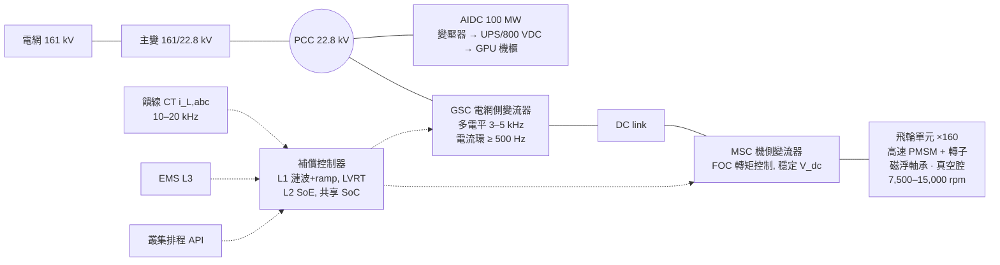
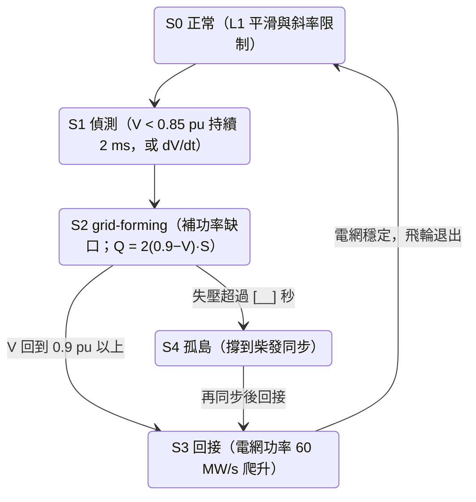

# 04 · 控制設計

飛輪是**並聯在 PCC 的可控電流源**，不串在機房供電路徑上：飛輪失效時最壞退回「無補償」，不影響機房供電（失效安全）。

## 4.1 系統架構



示意配置（100 MW AIDC）：**80 MW／0.8 MWh**＝160 × 500 kW／5 kWh 飛輪單元，經 DC link 接 4 × 20 MW grid-forming PCS。電壓等級為台灣常見配置示意。

## 4.2 四層控制，時間尺度各差約三個數量級

| 層 | 時間尺度 | 功能 |
|---|---|---|
| L0 電力電子內環 | 10 µs – 1 ms | 馬達／發電機 FOC、PCS 電流環與 DC link 電壓、磁浮軸承位置控制（主要靠 PCS／飛輪廠商） |
| **L1 功率平滑與故障穿越** | 1 ms – 10 s | 產生電網功率／電流參考；V < 0.85 pu 時 2 ms 內切 grid-forming 並注入無功（本提案核心） |
| L2 能量與單元管理 | 1 s – 10 min | SoE／轉速回中、依各單元 SoE 加權分配功率、排程前饋預先調整 SoE 目標 |
| L3 EMS 與電網服務 | 分鐘 – 小時 | 需量與電價、FFR 等輔助服務、預測維護、與調度通訊 |

## 4.3 L1（功率域）：電網只看到「慢、且斜率有上限」的負載

```
P_grid* = RateLimit_R[ LPF₂(P_load) + K·(SoE* − SoE)·P_max ]
P_fw*   = P_load − P_grid*          → SoE 視窗限幅 → PCS 電流環 → 飛輪
```

| 參數 | 示意值 | 依據 |
|---|---|---|
| τ₁, τ₂（二階低通） | 2.5 s | 轉角 0.064 Hz，低於 0.1 Hz 敏感頻段；0.2 Hz 處 −21 dB、0.7 Hz 處 −42 dB |
| R（斜率限制） | 2 MW/s | 直接對應電網 ramp 規範（假設值，可設定） |
| K（SoE 回中） | 0.25 | SoE 偏差 0.3 時修正 6 MW；回中慢於 0.1 Hz，不會把擺盪漏回電網 |
| SoE* | 0.5（前饋 0.4／0.85） | 保留雙向裕度 |

**失效安全**：飛輪飽和（滿或空）時，差額自動回到電網；最壞情況退化成沒有儲能，不會讓機房斷電。

## 4.4 L1（dq 座標，v2）：d 軸抵銷漣波與 ramp，q 軸做 LVRT

```
i_L,abc --PLL + abc→dq--> i_Ld
i_gd*   = RateLimit[ LPF₂(i_Ld) + SoE 修正 ]
i_fwd*  = i_Ld − i_gd* + i_res*            (負載電流前饋 + 諧振補償)
i_q*    = 2·(0.9 − V)·I_N,  上限 1 pu      (LVRT 無功注入)
MSC：V_dc PI (20–50 Hz) → T_e* → FOC 轉矩環 (~300 Hz) → ω → SoE（回饋 L1）
```

- **諧振補償器**鎖定 k·f_iter；迭代頻率隨作業改變，以線上 FFT 自適應。
- **頻寬階層**：電流環 ≥ 500 Hz > 轉矩環 ≈ 300 Hz > V_dc 20–50 Hz；補償帶 0.05–60 Hz；LPF 0.064 Hz；SoE < 0.01 Hz。
- V_dc 由 MSC 穩定，GSC 吐出或吃進的能量反映為轉速變化。

## 4.5 PCS 頻寬是成敗關鍵：100 Hz 不夠，要到 500 Hz

示意模擬（R1：100 MW、T_iter 1.4 s、GPU 邊緣 5 ms）：

| 方案 | ΔI／I | 0.1–20 Hz RMS | 12 Hz 軸系 | 1 s ramp |
|---|---|---|---|---|
| 無補償 | 84% | 38.6% | 100% | 29 MW/s |
| 飛輪 PCS 10 Hz | 100% | 7.0% | 54% | 2.9 MW/s |
| 飛輪 PCS 100 Hz | 24.5% | 1.5% | 7.3% | 1.0 MW/s |
| **飛輪 PCS 500 Hz** | **1.1%** | **0.41%** | **0.8%** | **0.86 MW/s** |
| GPU 韌體（地板 90%） | 1.1% | 0.34% | 0.8% | 0.51 MW/s（代價：額外耗電約 30%） |

- **10 Hz 反而更差**：補償落後邊緣，殘差變成正負尖峰，正好打在軸系頻段。
- **怎麼做到 500 Hz**：多電平／交錯並聯（等效開關頻率 ≥ 5 kHz）、量測延遲 ≤ 100 µs、負載電流前饋。
- **和機櫃電容分工**：GB300 電容吃掉 < 1 ms 尖峰，飛輪不必追最陡的邊緣。

這會是與飛輪和 PCS 供應商談規格的第一條。

## 4.6 運轉模式（v2）

| 模式 | 觸發 | 動作 |
|---|---|---|
| M1 正常 | — | 抵銷漣波；電網電流 ramp ≤ R；SoE 目標依排程 0.4／0.85 |
| M2 驟降 | V < 0.85 pu | 負載照常運轉不轉供；電網電流 ≤ 1.25 pu；q 軸注入無功 |
| M3 恢復 | V > 0.9 pu | 電網電流約 90 MW/s 回升，1 s 內 ≥ 90%；ramp 豁免窗 |
| M4 能量邊界 | SoE 接近 0／100% | 請 GPU 韌體限功率或 burn，維持 ramp 合規（論文的「共享 SoC」協同；介面可走 NVIDIA SMI／Redfish 與叢集排程 API） |

示意結果（R2）：恢復 0.64 s、故障電流 0.77 pu；20 MW/min 時純飛輪 ramp 超限 57 s／2 循環 → 加上 M4 協同後 0 s，代價是 GPU 限速約 9%。

## 4.7 故障穿越狀態機（v1）



對照傳統 UPS：欠壓超過約 4 ms 即切到電池／柴發；重複故障後不自動回接，負載離網數小時。門檻值為示意，正式值依台電併網規範與 ERCOT／NERC 穿越要求校正。

## 4.8 L2：用轉速管理能量

```
E   = ½ J ω²
SoE = (ω² − ω²_min) / (ω²_max − ω²_min)
```

- 7,500–15,000 rpm → 可用 75% 動能（0.8 MWh）；SoE 由轉速直接算出，沒有鋰電 SOC 估算漂移；接近上下限 5% 內線性降額。
- **回中**：SoE 偏離目標時，在電網參考加入慢速修正。
- **分配**：放電依 SoE 加權、充電依 1 − SoE 加權，自動均衡；4 台故障仍有 78 MW。
- **停放**：長時間閒置時降速停放，降低風阻與軸承損耗。
- **健康**：振動、軸承溫度、真空度趨勢上傳 L3 做預測維護（見 [07 飛輪 SOH](./07-flywheel-soh.md)）。

## 4.9 前饋與頻譜守門

**排程前饋（L2）**：向叢集排程 API 取得作業啟動、checkpoint、預定停機（提前數十秒）。啟動前 SoE 目標拉到 0.85；訓練中降到 0.40，留空間吸收當機。不可預測的當機靠保留裕度與 L1 自然吸收。

**頻譜守門（最後防線）**：PCC 10 kHz 取樣，滑動 FFT 依 0.1–20 Hz 分箱比對門檻。

1. 一級：超標即降低 L1 轉角、提高平滑強度。
2. 二級：持續超標，透過 NVIDIA SMI／Redfish 要求 GPU 開啟功率地板。
3. 三級：仍超標，依與調度的約定降載或切負載。

原則：**飛輪先吸收，GPU 地板只當備援**：平常不燒電，緊急時仍有退路。
