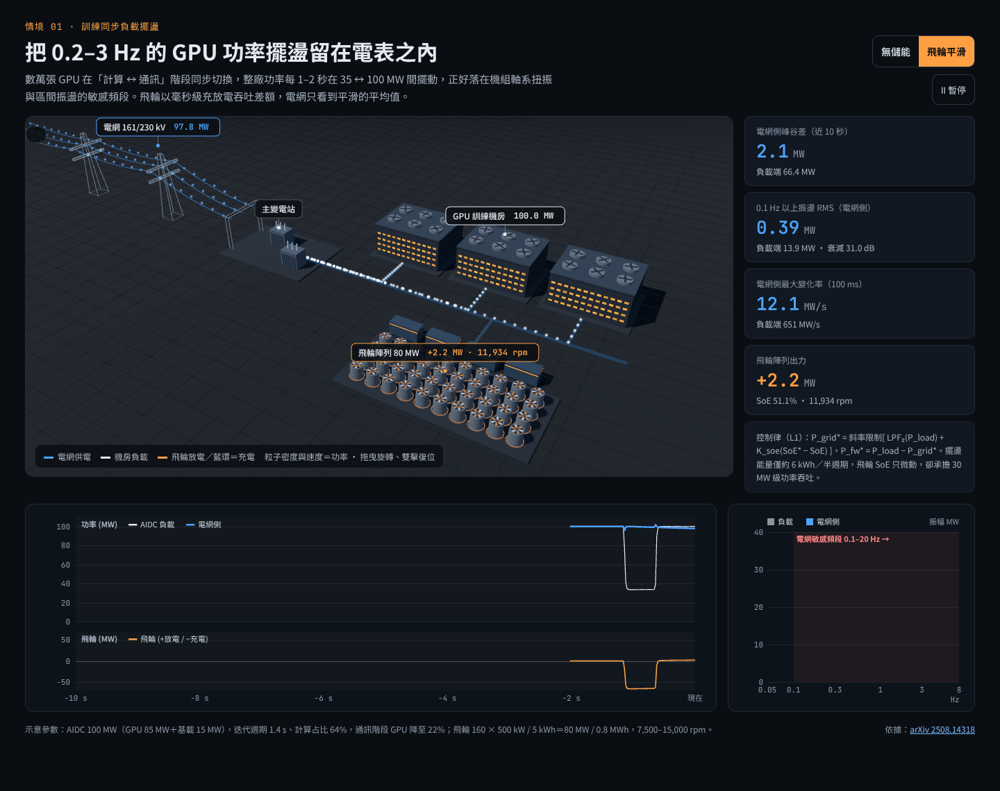
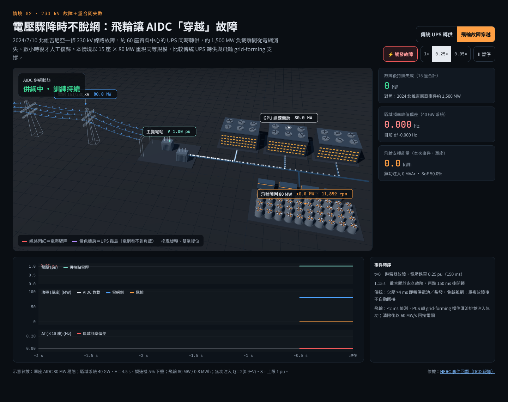
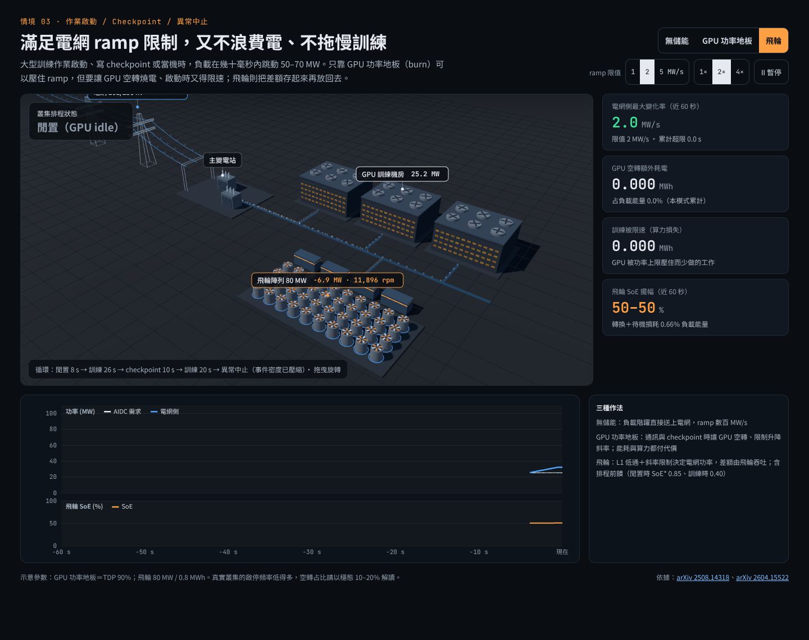
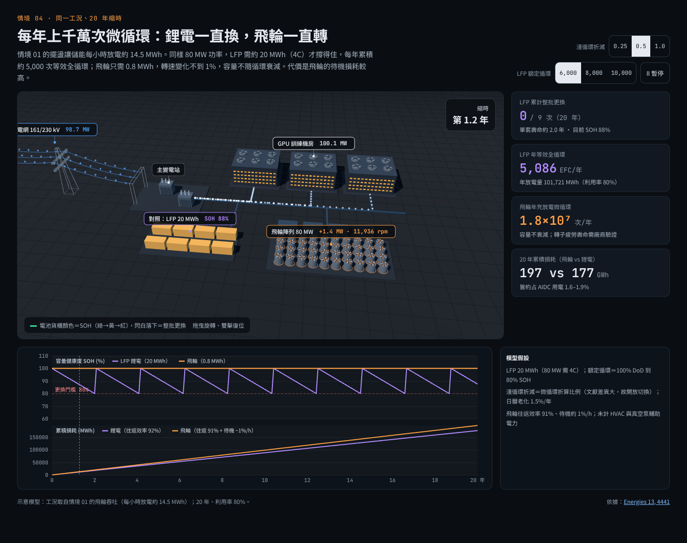
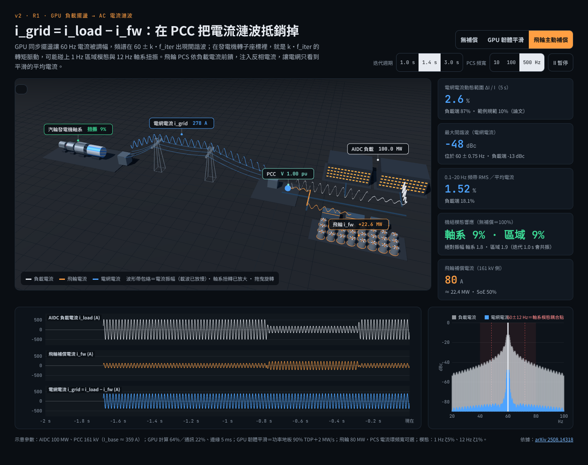
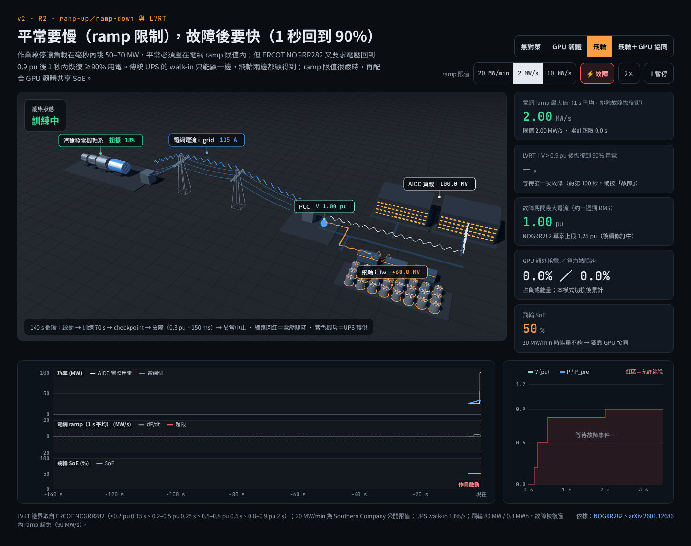

# 06 · 3D 模擬模型與結果

六個互動 3D 情境都是**示意模型**：用來說明機理與趨勢，不是 EMT 模擬，也不是廠商數據。正式設計需 EMT（PSCAD／RTDS）與當地電網規範。

- 線上直接開：[`sim/index.html`](../sim/index.html)（單一 HTML，已內嵌 three.js，可離線開啟）
- 重新產生或修改：[`skill/aidc-flywheel-3d`](../skill/aidc-flywheel-3d/)

## 6.1 情境目錄

| 情境 | 檔案 | 展示什麼 | 可切換 |
|---|---|---|---|
| S1 同步擺盪 | [S1-sync-swing.html](../sim/S1-sync-swing.html) | GPU 同步擺盪 0.2–3 Hz，飛輪平滑；附功率頻譜 | 無儲能、飛輪 |
| S2 故障穿越 | [S2-fault-ride-through.html](../sim/S2-fault-ride-through.html) | 230 kV 故障＋重合閘；UPS 轉供脫網 vs 飛輪穿越；區域頻率 | UPS、飛輪 |
| S3 作業啟停 | [S3-job-ramp.html](../sim/S3-job-ramp.html) | 作業啟動、checkpoint、當機的 ramp；GPU 空轉 vs 飛輪 | 無、GPU 地板、飛輪；ramp 限值 |
| S4 20 年壽命 | [S4-lifecycle.html](../sim/S4-lifecycle.html) | 20 年縮時：LFP 衰減更換 vs 飛輪不衰減，含損耗 | 淺循環折減、額定循環 |
| R1 電流漣波 | [R1-current-ripple.html](../sim/R1-current-ripple.html) | i_grid = i_load − i_fw 波形帶、60 Hz 間諧波頻譜、軸系扭振 | 無補償、GPU 韌體、飛輪；T_iter、PCS 頻寬、邊緣 |
| R2 ramp／LVRT | [R2-ramp-lvrt.html](../sim/R2-ramp-lvrt.html) | ramp 限值與 LVRT（ERCOT NOGRR282）恢復檢查 | 無、GPU、飛輪、協同；ramp 限值；觸發故障／啟停 |

操作：拖曳旋轉 3D、雙擊復位；上方按鈕切換模式與參數。網頁上的即時 KPI 是滑動視窗，開頁後約 20–30 秒才穩定。

## 6.2 模型摘要

- **GPU 負載**：P = base + gpuPeak·g(t)；計算（占 64%）g = 1、通訊 g = 0.22；一階邊緣 v1 12 ms、v2 5 ms；週期 T_iter ± 4–5% 抖動。
- **飛輪**：E = ½Jω²；7,500–15,000 rpm；PCS 一階延遲（v1 2 ms；v2 τ = 1／(2π·bw)）；單向效率 0.955、待機約 1%/h；SoE 邊界 4–5% 內線性降額。
- **L1 控制**：見 [04 控制設計](./04-control-design.md)；排程前饋閒置 SoE* = 0.85、訓練 0.40。
- **GPU 韌體**：功率地板 = base + 0.9·gpuPeak，升降受 ramp 限制。
- **故障**：S2 為 0.25 pu 150 ms → 重合閘 → 再 150 ms；R2 為 0.3 pu 150 ms。UPS：欠壓即轉供，walk-in 10%/s。飛輪：驟降時電網功率 ≤ P·V／0.9，恢復後 90 MW/s（豁免窗 6 s）；Q = 2(0.9 − V)·P_max。
- **區域頻率**（S2）：搖擺方程式＋下垂，40 GW、H 4.5 s、R 5%。
- **電流**（v2）：I = P／(√3·V)，100 MW @161 kV ≈ 359 A；間諧波＝電流包絡頻譜。模態 1 Hz（ζ 5%）、12 Hz（ζ 1%）。
- **壽命**（S4）：LFP 20 MWh、額定 6,000 次、淺循環折減 0.5、日曆 1.5%/年，80% 更換。

## 6.3 引擎基準結果（目前版本，可重現）

以 `skill/aidc-flywheel-3d/scripts/check_engine.js` 執行預設參數：

| 情境 | 指令 | 關鍵數字 |
|---|---|---|
| S1 40 s | `--engine sim --kind s1 --modes none,fw` | 峰谷差 66.5 → 2.3 MW；ramp（100 ms）661 → 14 MW/s；衰減約 32 dB |
| S2 8 s | `--engine sim --kind s2 --modes ups,fw` | 持續失載 1,201 → 0 MW；頻率峰值 0.26 → 0.11 Hz；飛輪 21 kWh |
| S3 234 s | `--engine sim --kind s3 --modes none,burn,fw` | 超限 39／0／29 s（100 ms 斜率）；burn 額外耗電 1.97 MWh |
| S4 5 s | `--engine sim --kind s4` | EFC 5,086／年；20 年更換 9 次；損耗 177 vs 197 GWh |
| R1 30 s | `--engine ripple --kind ripple --modes none,gpu,fw` | ΔI/I 84 → 1.1%；間諧波 −13 → −55 dBc；軸系 100 → 0.8%；GPU 耗電約 30% |
| R1 30 s | `... --modes fw --opts '{"bw":100}'` | ΔI/I 24.5%；軸系 7% |
| R2 280 s | `--engine ripple --kind ramp --modes none,gpu,fw,hyb --opts '{"ramp":2}'` | 超限 183／11／0／0 s；恢復 3.0／>8／0.64 s；電流 1.00／0.97／0.77 pu |
| R2 280 s | `... --modes fw,hyb --opts '{"ramp":0.3333}'` | 超限 57 → 0 s；hyb 限速約 9% |

## 6.4 v2 簡報結果總表

| 情境 | 指標 | 無對策 | GPU 韌體 | 飛輪 |
|---|---|---|---|---|
| R1 | 電網電流 ΔI／I | 84% | 1.1% | 1.1% |
| R1 | 最大間諧波 | −13 dBc | −53 dBc | −55 dBc |
| R1 | 12 Hz 軸系響應 | 100% | 0.8% | 0.8% |
| R1 | 1 Hz 模態（T_iter 1.0 s） | 共振，放大 4.7 倍 | 0.9% | 0.4% |
| R1 | 額外耗電 | 0 | 約 30% | 0（損耗另計） |
| R2 | ramp 超限（2 MW/s，2 循環） | 183 s | 11 s | 0 s |
| R2 | LVRT 恢復至 90% | 3.0 s | > 8 s | 0.64 s |
| R2 | 故障期間最大電流 | 1.00 pu | 0.97 pu | 0.77 pu |
| R2 | 額外耗電／算力限速 | 0／0 | 41%／8% | 0／0 |

## 6.5 已知問題：v1 簡報與目前引擎的數字落差

v1 簡報第 2、13 頁的部分數字，與目前瀏覽器版引擎（步長 1 ms）的輸出不一致：

| 項目 | v1 簡報 | 目前引擎 | 原因 |
|---|---|---|---|
| S1 電網側峰谷差（10 s 視窗） | 0.7 MW | **約 2.3 MW** | 引擎步長與 PCS 延遲模型修改後，殘差尖峰變大 |
| S1 最大變化率（100 ms） | 1.8 MW/s | **約 14 MW/s** | 同上；100 ms 斜率對殘差尖峰敏感 |
| S3 飛輪 ramp 超限時間 | 0 s | **約 29 s** | S3 仍以 100 ms 斜率計算；v2 R2 已改用 1 s 平均（排除故障恢復窗） |

結論方向不變（飛輪大幅改善），但**引用 v1 數字前請以本表為準**。待辦：把 S3 改為 1 s 平均 ramp 指標，並更新 v1 簡報數字（見 [CHANGELOG](../CHANGELOG.md)）。v2 簡報數字與目前引擎一致。

## 6.6 其他限制

- 圖表刻度以 100 MW 廠區為準；負載改大很多會出界，建議用「每 100 MW」呈現。
- 模態、區域系統、LVRT 邊界都是示意值。
- 3D 中的軸系扭轉、波形帶載波經過放大／放慢，僅供視覺化。
- 3D 標籤與圖表標題為中文，寫死在 assets。

## 6.7 截圖

| | |
|---|---|
|  |  |
|  |  |
|  |  |
