# 飛輪儲能穩定 AIDC 動態負載：控制邏輯與導入效益（v1）—逐頁大綱與講稿

檔案：[PPTX](./2026-11-02_AIDC飛輪儲能_控制邏輯與導入效益_簡報_v1.pptx) · [PDF](./2026-11-02_AIDC飛輪儲能_控制邏輯與導入效益_簡報_v1.pdf)

> 數字來自自建**示意模型**（100 MW AIDC、飛輪 80 MW／0.8 MWh），不是廠商數據。

## 01. 以飛輪儲能 穩定 AIDC 動態負載

**講稿：**開場一句話：AI 訓練機房的用電不是一條平線，而是每秒來回一次、幅度幾十 MW 的方波。我們的提案是用飛輪而不是鋰電，把這個方波在電表內吸收掉。今天會講三件事：問題有多嚴重、飛輪怎麼控制、以及需要您核准的 PoC。右下角這個圖就是整份簡報的重點：左邊鋸齒進去，經過飛輪，右邊電網只看到一條平線。

## 02. 飛輪是 AIDC 與電網之間的「減震器」
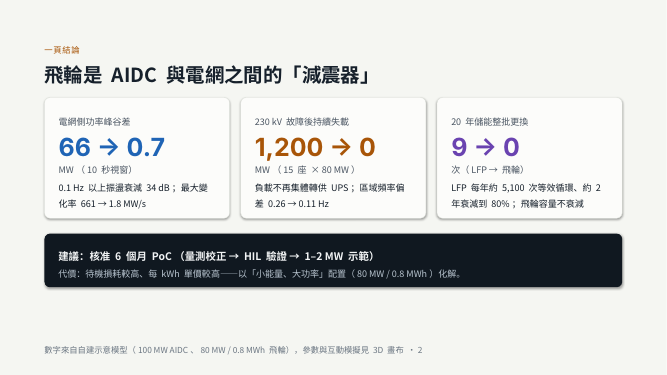

**講稿：**先講結論。三個數字對應三個痛點：第一是平常就在發生的同步擺盪，飛輪把電網側的峰谷差從 66 MW 壓到不到 1 MW；第二是電網故障時的集體脫網，北維吉尼亞 2024 年就發生過 1,500 MW 的案例，飛輪讓負載留在網上；第三是壽命，同樣工況下鋰電大約兩年就要換一次，20 年換 9 次，飛輪不衰減。這些是示意模型，不是廠商數據，所以我們要做 PoC 用真實波形校正。代價我也會誠實講：飛輪待機損耗比較高，每 kWh 也比較貴，所以我們只讓它做它擅長的事——秒級、高功率。

## 03. AI 訓練負載：數十 MW、每秒來回一次的方波
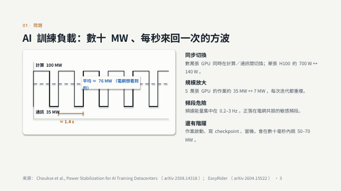

**講稿：**AI 訓練跟一般雲端機房最大的差別是「同步」。所有 GPU 一起算、一起交換梯度，所以整座機房的功率就像一個方波。單卡 H100 從 700 瓦掉到 140 瓦，五萬張卡就是 35 MW 掉到 7 MW。微軟、OpenAI、NVIDIA 聯名的論文量到主要頻譜在 0.2 到 3 Hz，剛好是電網最怕的頻段。除了週期擺盪，還有作業啟動、checkpoint、當機這種一次性的階躍。藍色虛線是電網希望看到的：一條平均值。我們的工作就是把黑線變成藍線。

## 04. 對電網的三種風險，第三種正在變成法規
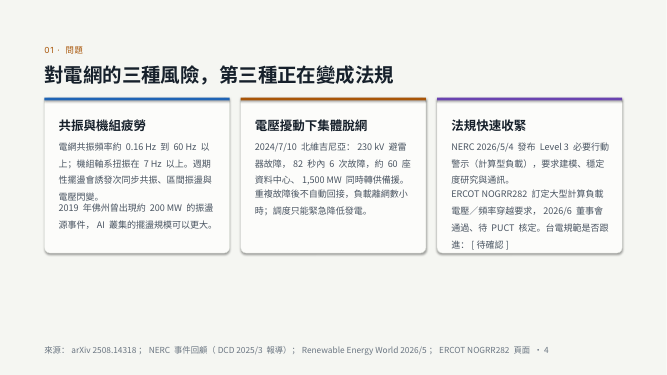

**講稿：**風險有三層。第一層是頻率：擺盪落在電網共振頻段，長期會讓汽輪機軸系疲勞，論文舉了 2019 年佛州 200 MW 振盪源的例子。第二層是故障：北維吉尼亞那次是一條 230 kV 線路的避雷器壞掉，82 秒內重合閘失敗 6 次，60 座資料中心的 UPS 一起切走，1,500 MW 負載憑空消失，調度只能緊急降發電。第三層是法規：NERC 今年 5 月發了 Level 3 警示，ERCOT 的穿越要求也已經過董事會。台灣這邊台電會不會跟進還要確認，但趨勢很清楚：能穿越、能平滑的 AIDC，併網會更容易。

## 05. 現有解法都能用，但各有代價
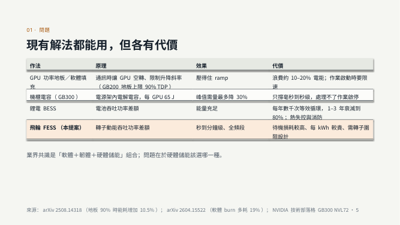

**講稿：**現有作法大概四種。第一種最便宜：讓 GPU 在通訊時空轉，把功率墊高，NVIDIA GB200 已經內建功率地板，但代價是白燒電，論文量到 10% 到 19% 的額外能耗，而且作業啟動時要故意限速。第二種是 GB300 在電源架裡塞電容，每張卡 65 焦耳，可以削峰 30%，但只撐得了毫秒到秒級，作業啟停那種幾十秒的事件撐不住。第三種是鋰電，能量夠，可是這個工況每年幾千次循環，一到三年就衰減，還有消防問題。所以業界的共識是組合拳，我們要回答的是硬體那一塊選什麼——我們的答案是飛輪。

## 06. 為什麼是飛輪：功率大、時間短、循環極多
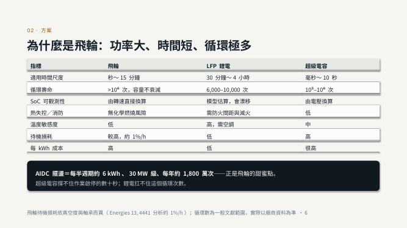

**講稿：**這張是技術選型的核心。關鍵不是誰比較好，而是工況匹配。AIDC 擺盪的特徵是：每半個週期只有大約 6 度電，可是功率是 30 MW 等級，而且一年要來回大約 1,800 萬次。鋰電是能量型，6,000 到 10,000 次循環在這裡一兩年就用完；超級電容循環夠，但能量太小，作業啟停那種要撐幾十秒的事件不行。飛輪剛好卡在中間：秒到分鐘級、循環幾乎不限、SoC 直接從轉速算，沒有估算誤差，也沒有熱失控。缺點我也寫上去了：待機損耗比較高，每 kWh 比較貴，所以我們只配小能量。

## 07. 系統架構：飛輪掛在中壓匯流排，與機房並聯
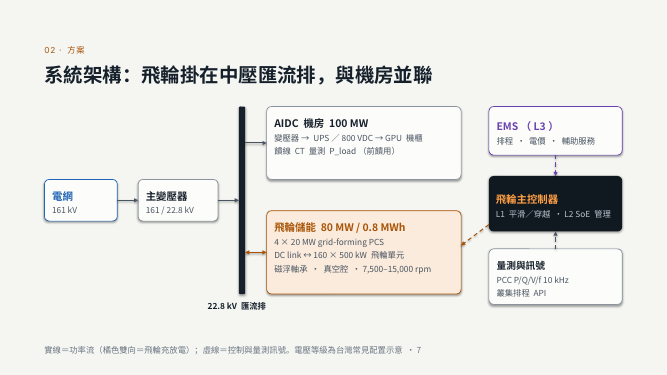

**講稿：**架構很單純：飛輪不串在機房裡，而是跟機房並聯掛在 22.8 kV 中壓匯流排上，這樣不用動客戶的 UPS 和機櫃設計，也可以一套飛輪服務多棟機房。160 台 500 kW 的飛輪單元經由 DC link 接到 4 台 20 MW 的 grid-forming PCS。控制器吃三種訊號：併接點的高速量測、機房饋線的負載量測，以及叢集排程器的 API，知道什麼時候要開訓練、寫 checkpoint。上面還有 EMS 負責電價、需量和輔助服務。這是我們 EMS 團隊本來就熟的分層架構。

## 08. 控制分四層，時間尺度各差約三個數量級
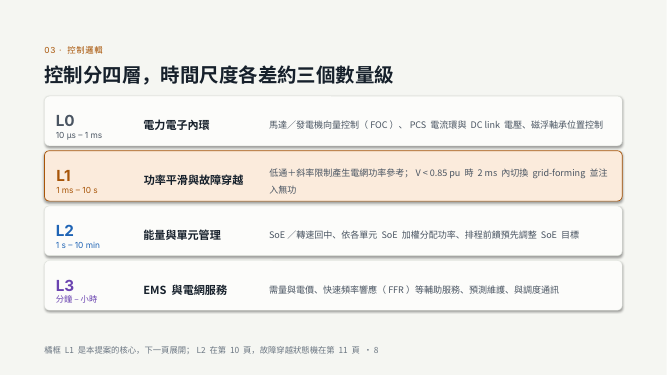

**講稿：**控制分四層，這跟我們做換電站 EMS 的分層邏輯是一樣的，只是時間尺度更快。L0 是電力電子內環，微秒到毫秒，主要靠 PCS 和飛輪廠商。L1 是我們的核心價值：決定電網應該看到什麼功率，以及電壓掉下來時怎麼接手，毫秒到秒級。L2 管能量：轉速別撞到上下限、160 台之間怎麼分工、排程器說要開訓練了就先把能量備好。L3 就是 EMS 本行：電價、需量、輔助服務、預測維護。我們團隊真正要寫的是 L1 到 L3。

## 09. L1 核心：電網只看到「慢、且斜率有上限」的負載
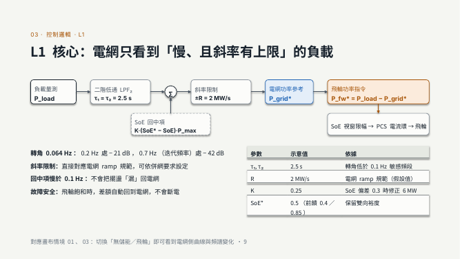

**講稿：**這是整個控制的心臟，其實只有三個方塊。負載量測進來，先過一個二階低通，時間常數 2.5 秒，轉角大約 0.06 Hz，所以 0.7 Hz 的迭代擺盪會被壓 42 dB。再加上一個很慢的 SoE 回中項，讓飛輪不會一直往同一邊漂。最後過斜率限制，這個數字就是電網的 ramp 規範。出來的就是電網該看到的功率；負載減掉它，就是飛輪要出的功率。這個架構有一個很重要的特性：飛輪如果滿了或空了，差額會自然回到電網，最壞情況就是退化成沒有儲能，不會讓機房斷電。

## 10. L2：用轉速管理能量，160 台單元分工
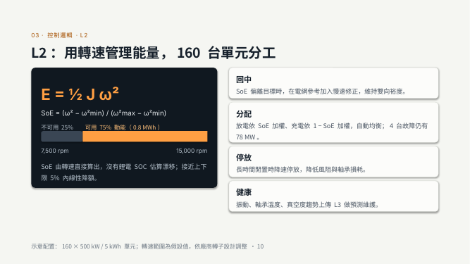

**講稿：**L2 管能量。飛輪最大的好處之一是 SoE 不用猜：能量就是二分之一 J omega 平方，轉速量得到就知道還剩多少，不像鋰電要靠模型估，越老越不準。我們讓轉速在 7,500 到 15,000 轉之間運作，可以用掉 75% 的動能。160 台之間怎麼分工也很簡單：放電時轉得快的多出力，充電時轉得慢的多吃電，自然會均衡；壞掉 4 台還有 78 MW。閒置時降速停放可以省待機損耗，振動和真空度的趨勢則交給 L3 做預測維護。

## 11. 故障穿越狀態機：2 ms 內接手，清除後約 1 秒回接
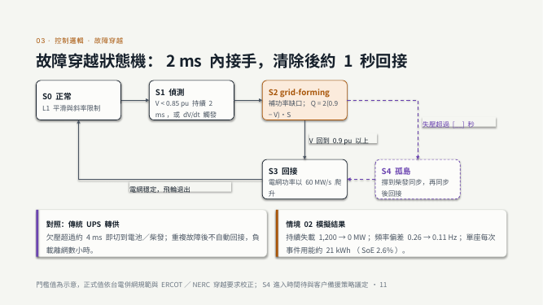

**講稿：**故障穿越是飛輪第二個殺手級應用。正常時在 S0 做平滑。電壓掉到 0.85 pu 以下超過 2 毫秒，進入 S1 確認，馬上切到 S2：PCS 變成 grid-forming，自己撐住匯流排電壓，把電網送不進來的功率補上，同時照 LVRT 曲線注入無功幫電網把電壓撐起來。故障清除、電壓回到 0.9 以上，進 S3，讓電網功率以每秒 60 MW 爬回去，大約一秒，飛輪退出。如果電網真的長時間失壓，就進 S4 孤島，撐到柴發同步。跟傳統 UPS 最大差別是：負載從頭到尾沒有從電網上消失。模擬裡 15 座機房的持續失載從 1,200 MW 變成 0。

## 12. 向排程器要訊號，在併接點盯頻譜
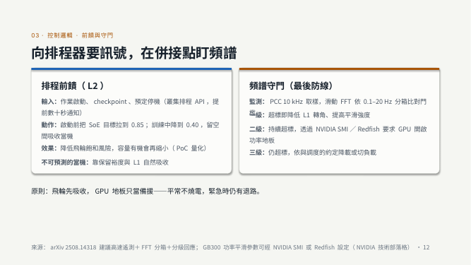

**講稿：**這頁講兩個讓系統更聰明、也更安全的機制。左邊是前饋：AI 叢集的作業是排程出來的，啟動、checkpoint、停機，排程器都事先知道。我們跟排程 API 接，提前把飛輪轉速備好：要開訓練了就先充飽，訓練中留一半空間吸收當機。右邊是守門：在併接點做高速 FFT，盯 0.1 到 20 Hz，超標就分三級處理，第一級調我們自己的控制，第二級才去叫 GPU 開功率地板，第三級才降載。這也是微軟那篇論文建議的架構。重點是：GPU 空轉燒電只當最後手段，不是常態。

## 13. 四個情境的模擬結果（示意模型）
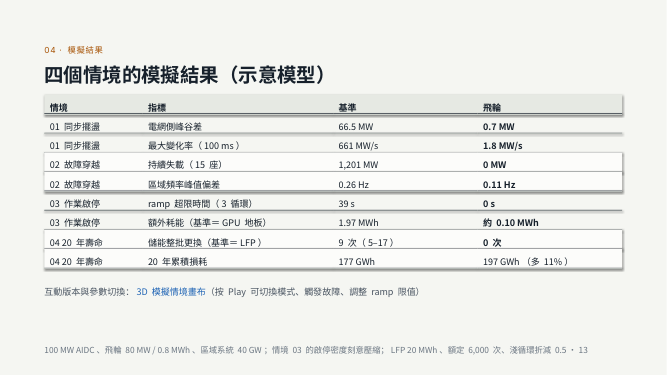

**講稿：**這是四個情境的數字總表，全部來自我們自己寫的示意模型，畫布上都可以互動。重點看粗體：擺盪、變化率、故障失載、ramp 超限，飛輪都幾乎歸零。最後一行我刻意放上來：20 年累積損耗飛輪比鋰電多 11%，因為飛輪有待機損耗。但跟 GPU 地板那種白燒電比，這個損耗小了約 20 倍；而鋰電在這個工況要換 9 次，換電池的成本要放進 20 年 TCO 跟多出來的電費一起比，這是 PoC 要量化的項目。下一頁講這些代價怎麼處理。

## 14. 飛輪的代價與對策
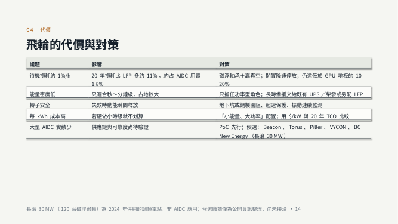

**講稿：**任何技術都有代價，我希望老闆聽到的是完整版。第一，待機損耗：飛輪靠真空和磁浮軸承降低損耗，但還是比鋰電高，20 年大約多 11%，這要放進 TCO。第二，能量密度低，所以我們只讓它做秒到分鐘級，長時間備援還是交給 UPS 和柴發。第三，轉子安全，業界做法是放地下坑或鋼製圍阻，加超速和振動保護。第四，每度電的單價高，所以我們刻意配小能量大功率，用每 kW 和 20 年 TCO 來比。第五，大型 AIDC 的實績還少，這正是 PoC 的目的。中國長治已經有 30 MW、120 台的飛輪調頻電站在跑，代表規模化在技術上是可行的。

## 15. 容量怎麼估：功率看擺幅，能量看斜率
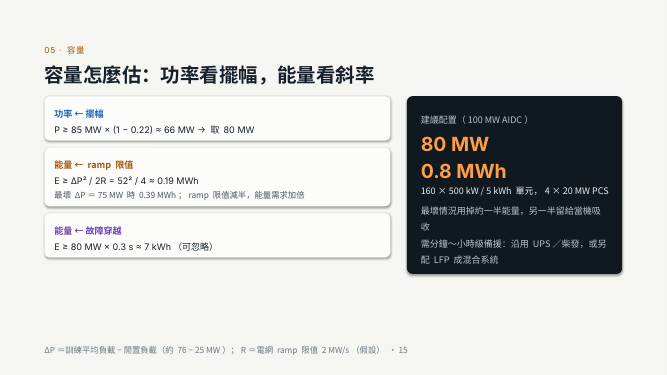

**講稿：**容量估算有一個很簡單的直覺：功率看擺幅，能量看斜率。功率要大於 GPU 擺動的幅度，85 MW 乘上 78% 大約 66 MW，我們取 80 MW。能量則由電網允許的斜率決定：負載瞬間跳 52 MW，電網只准每秒爬 2 MW，中間那個三角形就是飛輪要補的能量，ΔP 平方除以 2R，大約 0.19 MWh；最壞情況 75 MW 跳變是 0.39 MWh。故障穿越反而只要幾度電，可以忽略。所以 80 MW、0.8 MWh 的配置，最壞也只用一半。要注意的是 ramp 限值如果變嚴格一半，能量就要加倍，這是跟台電確認規範的關鍵參數。

## 16. 6 個月 PoC，請老闆決定三件事
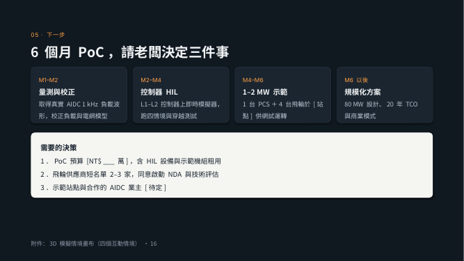

**講稿：**最後是請求。PoC 分四段：前兩個月拿真實 AIDC 的負載波形校正模型，這一步最重要，因為今天所有數字都是示意模型；第二到第四個月把我們的 L1、L2 控制器放上 HIL 即時模擬器，跑四個情境和穿越測試；第四到第六個月做 1 到 2 MW 的實機示範。需要您決定三件事：預算、是否啟動供應商 NDA，以及示範站點和合作的 AIDC 業主。預算數字和站點我先留空，會後跟財務一起補。
