# AIDC 電流漣波與 ramp／LVRT：飛輪主動電流補償方案（v2）—逐頁大綱與講稿

檔案：[PPTX](./2026-11-02_AIDC電流漣波與ramp-LVRT_飛輪主動電流補償_簡報_v2.pptx) · [PDF](./2026-11-02_AIDC電流漣波與ramp-LVRT_飛輪主動電流補償_簡報_v2.pdf)

> 數字來自自建**示意模型**（100 MW AIDC、飛輪 80 MW／0.8 MWh），不是廠商數據。

## 01. AIDC 電流漣波 與 ramp／LVRT 合規

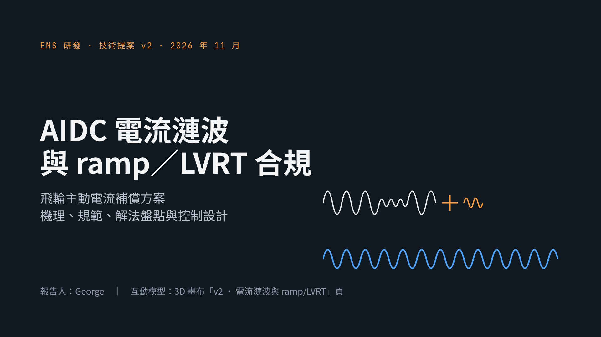

**講稿：**這份是第二版，聚焦兩個問題：第一，GPU 負載擺盪在 AC 端造成的電流漣波；第二，作業啟停的 ramp-up、ramp-down 要符合電網規範，同時故障時要符合 LVRT 穿越與恢復要求。主要參考微軟、OpenAI、NVIDIA 聯名的 Power Stabilization for AI Training Datacenters，再加上 ERCOT NOGRR282 等最新規範。右下角的圖就是解法的核心概念：負載電流被調幅，飛輪注入反相的補償電流，電網電流的振幅就固定了。

## 02. 同一套飛輪 PCS，同時解電流漣波、ramp 與 LVRT

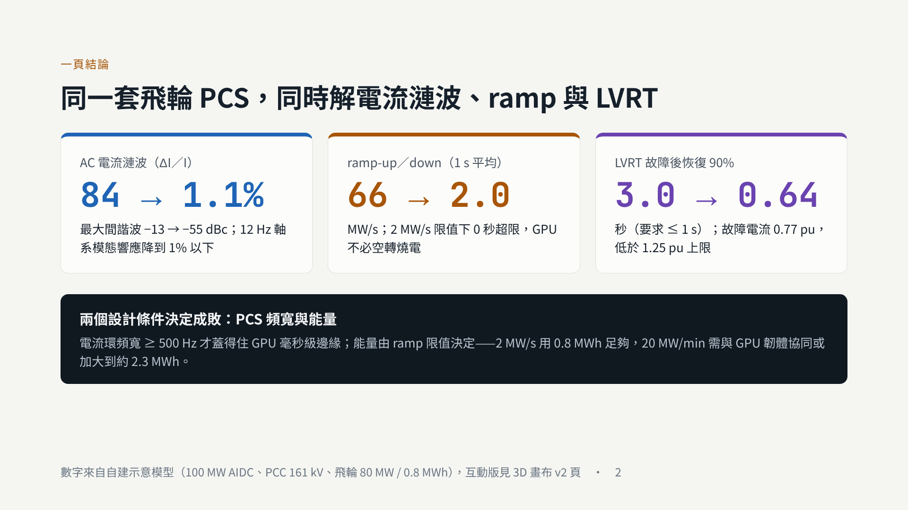

**講稿：**先講結論。兩個問題可以用同一套飛輪 PCS 處理，因為本質上都是「電網側電流應該長什麼樣子」的問題。電流漣波：負載電流的動態範圍 84%，補償後 1.1%，最大間諧波從 −13 dBc 壓到 −55 dBc，連 12 Hz 軸系模態的響應都降到 1% 以下。ramp：電網看到的變化率從 66 MW/s 壓到 2 MW/s，而且不需要讓 GPU 空轉。LVRT：電壓恢復後 0.64 秒就回到 90% 用電，符合 ERCOT 的 1 秒要求，傳統 UPS walk-in 要 3 秒。成敗看兩個參數：PCS 電流環頻寬要到 500 Hz 等級，能量大小要看電網給的 ramp 限值。

## 03. GPU 訓練負載：同步方波，邊緣只有幾毫秒

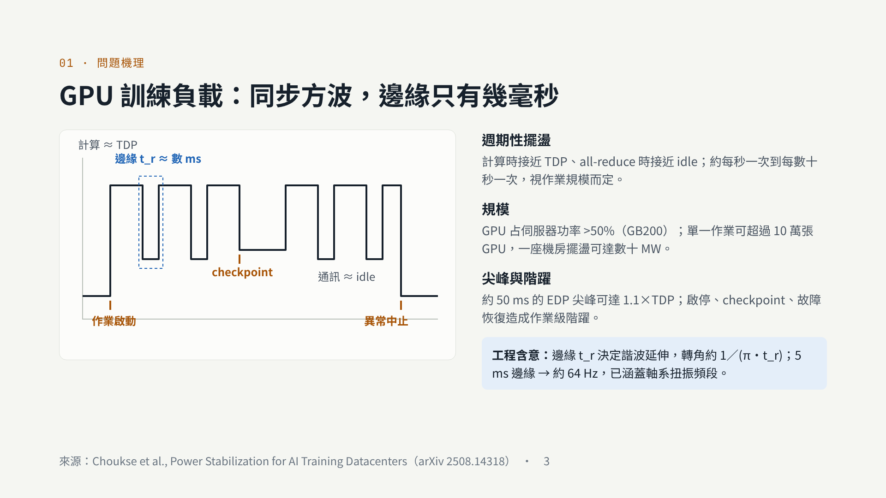

**講稿：**論文把 GPU 的行為講得很清楚：計算階段 tensor core 滿載接近 TDP，通訊階段做 all-reduce 或 checkpoint 時接近 idle，週期從一秒一次到幾十秒一次。GB200 上 GPU 占伺服器功率一半以上，單一作業可超過十萬張卡。還有 50 毫秒等級的 EDP 尖峰，以及啟停和故障恢復的階躍。我特別加了一個工程觀點：方波的邊緣時間決定諧波延伸到多高，5 毫秒的邊緣，諧波一路延伸到 60 幾 Hz，已經涵蓋汽輪機軸系扭振的頻段。所以不只看擺盪週期，也要看邊緣多陡。

## 04. 功率擺盪 → 電流調幅 → 60 Hz 兩側的間諧波

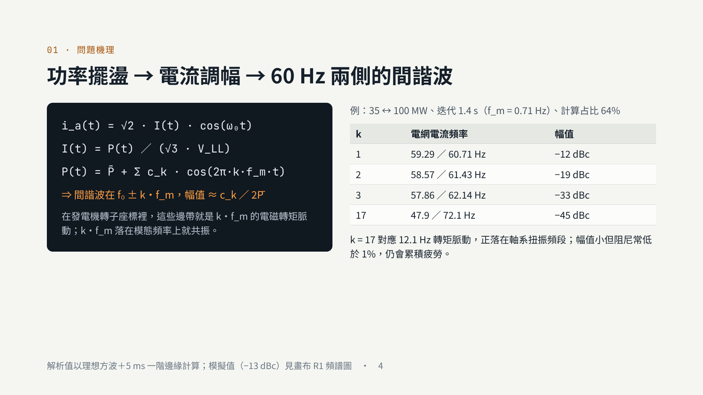

**講稿：**這頁是電流漣波的物理。電壓近似固定，電流振幅就跟著功率走，等於 60 Hz 載波被 GPU 方波調幅。調幅在頻譜上的樣子就是 60 Hz 兩側出現邊帶，也就是間諧波，位置在 60 加減 k 倍迭代頻率。以 1.4 秒迭代為例，第一對邊帶在 59.29 和 60.71 Hz，只比基波低 12 dB，非常大。更重要的是，從發電機轉子看，這些邊帶就是 k 倍迭代頻率的轉矩脈動。第 17 次諧波剛好在 12 Hz，落在軸系扭振頻段，雖然只有 −45 dBc，但軸系阻尼通常不到 1%，長期累積就是疲勞。所以我們的目標不只是壓低漣波，而是要壓低整個 0.1 到幾十 Hz 的邊帶。

## 05. AI 負載的頻譜，正好疊在電網最怕的頻段上

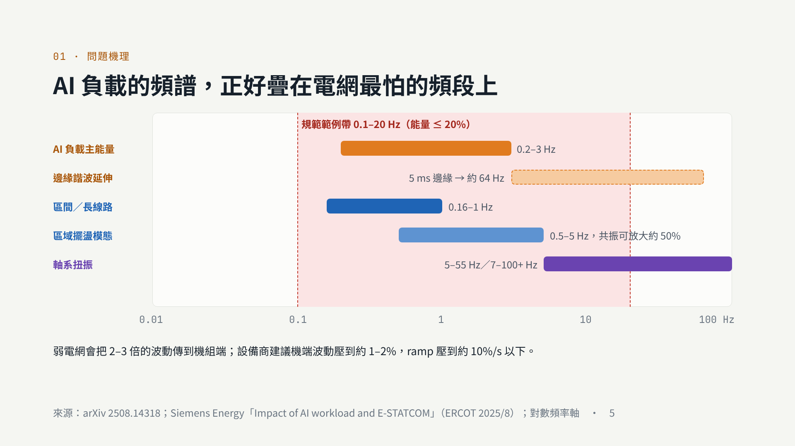

**講稿：**把頻率軸攤開來看就很清楚。橘色是 AI 負載：主能量在 0.2 到 3 Hz，邊緣的諧波一路延伸到 60 Hz 附近。藍色是電網的機電模態：區間和長線路模態在 0.16 到 1 Hz，區域擺盪模態在 0.5 到 5 Hz，西門子的研究說共振可放大約 50%。紫色是汽輪機軸系扭振，西門子說 5 到 55 Hz，論文說 7 到 100 Hz 以上。紅框是論文舉的規範範例：0.1 到 20 Hz 的能量要限制。幾乎所有東西都疊在一起，所以只做低頻平滑不夠，補償頻寬要蓋到幾十 Hz。另外弱電網會把波動放大 2 到 3 倍傳到機組端，台灣電網相對孤立，這點要特別注意。

## 06. ramp 與動態範圍：規範正在成形，數字各家不同

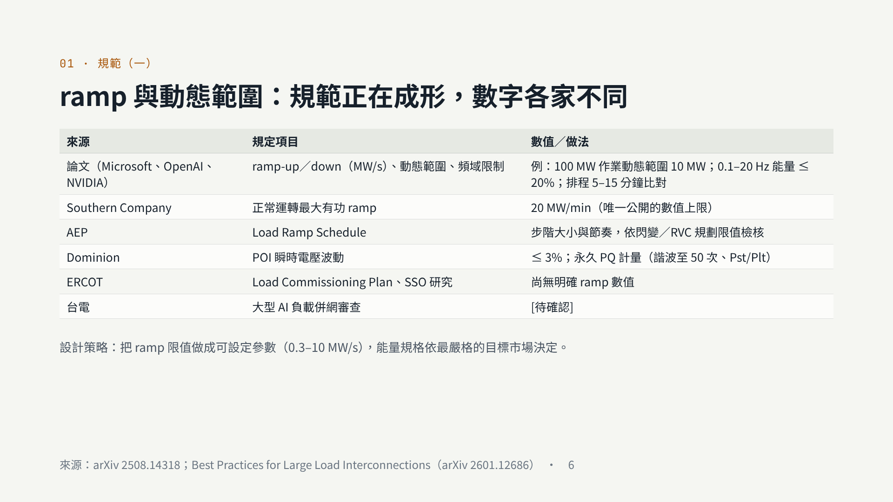

**講稿：**規範的第一部分是 ramp 和動態範圍。論文提出的框架很實用：時域看 ramp-up、ramp-down 和短時動態範圍，頻域看 0.1 到 20 Hz 的能量。實際各家電力公司的數字差很多：Southern Company 是唯一給出明確數值的，每分鐘 20 MW，非常嚴；AEP 要提交 ramp 計畫；Dominion 管電壓波動 3%；ERCOT 目前還沒有明確 ramp 數值，但會做次同步振盪研究。台電的要求我們還要去確認。所以我們的設計把 ramp 限值做成參數，能量規格則看最嚴格的目標市場。

## 07. LVRT：ERCOT NOGRR282 給了第一套完整的負載穿越規格

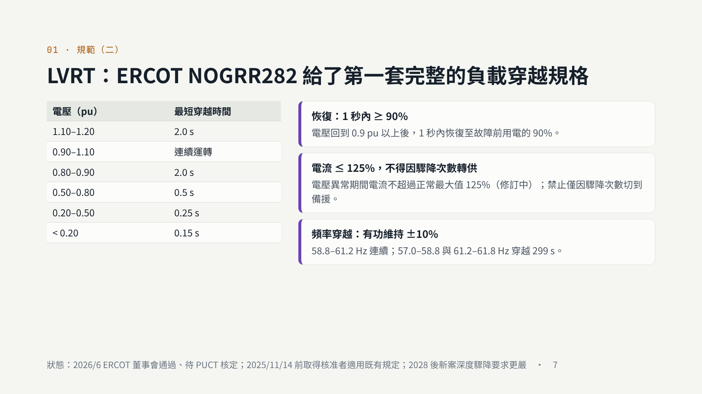

**講稿：**規範的第二部分是 LVRT。ERCOT 的 NOGRR282 是目前最完整的大型計算負載穿越規格，今年 6 月董事會通過，等德州公用事業委員會核定。左邊是電壓與穿越時間的表，例如掉到 0.2 到 0.5 pu 要撐 0.25 秒。右邊三個重點：第一，電壓回到 0.9 以上後，1 秒內要恢復 90% 用電，這條跟 ramp 限制直接衝突，下一頁講；第二，故障期間電流不能超過 125%，也不能因為驟降次數多就切到備援，這是針對北維吉尼亞事件；第三，頻率穿越期間有功要維持在 10% 以內。注意這是負載規範，不是發電機的 LVRT，但精神一樣。

## 08. 規範的兩端：平常要慢，故障後要快

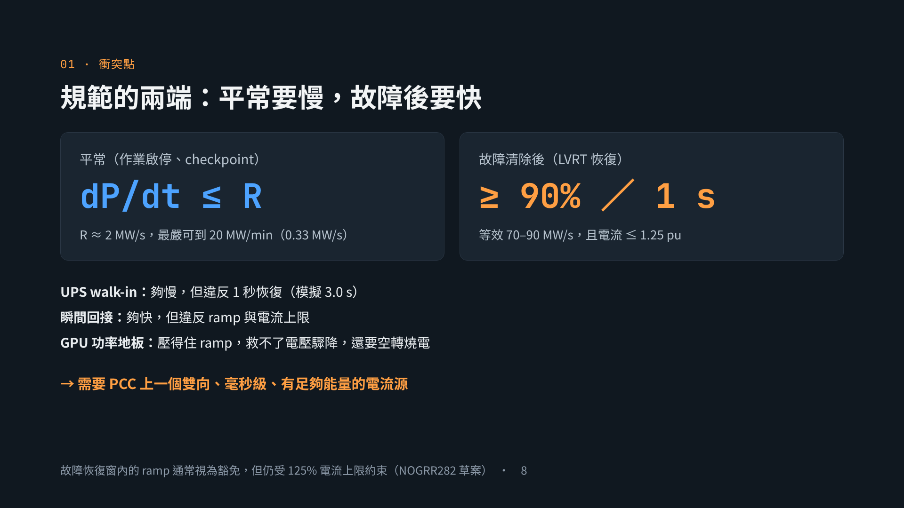

**講稿：**這頁是整份簡報的轉折。您提到 ramp-up、ramp-down 要符合 LVRT 的規範，實際上規範有兩端，而且方向相反。平常作業啟停時，電網要求變化率要慢，每秒 2 MW，最嚴的每分鐘 20 MW。可是故障清除後，ERCOT 又要求 1 秒內恢復 90% 用電，等於每秒 70 到 90 MW，還不能超過 1.25 倍電流。負載本身做不到兩全：UPS walk-in 慢，就違反恢復時間；瞬間回接，就違反 ramp 和電流；GPU 地板可以壓 ramp，但對電壓驟降無能為力，還要燒電。所以我們需要的是在 PCC 上一個雙向、毫秒級、有足夠能量的可控電流源，這就是飛輪 PCS 的角色。

## 09. 解法分布在五個層級，各自只蓋住一段

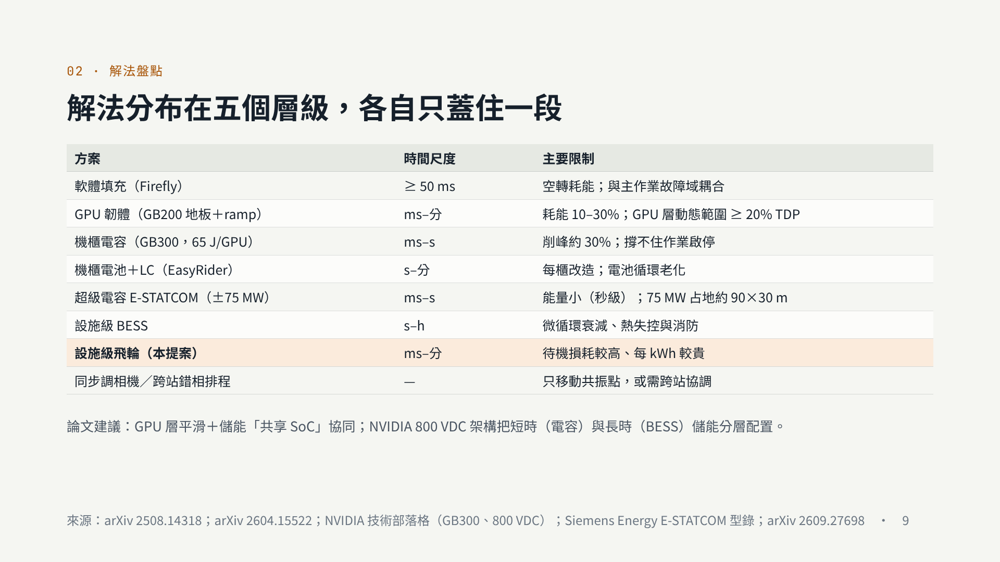

**講稿：**解法我整理成五個層級、八種方案。最靠近 GPU 的是軟體和韌體：Firefly 在空檔塞運算，GB200 有功率地板和 ramp 控制，便宜但都要燒電。機櫃層有 GB300 的電容，每張卡 65 焦耳，削峰 30%，但撐不了作業啟停；EasyRider 論文用機櫃電池加 LC 濾波，效果好但每個機櫃都要改。設施層有三種：西門子的 E-STATCOM 用超級電容，正負 75 MW 加無功，是我們最直接的競品，但能量是秒級；鋰電 BESS 能量大，但微循環會衰減；飛輪是我們的提案。最後是電網側的同步調相機，以及跨機房錯相排程，論文說錯開半個週期可以把振盪降到約 3%。論文的結論是 GPU 層和儲能要協同、共享 SoC，我們的設計會照這個原則。

## 10. 時間尺度對照：誰能從毫秒一路蓋到分鐘

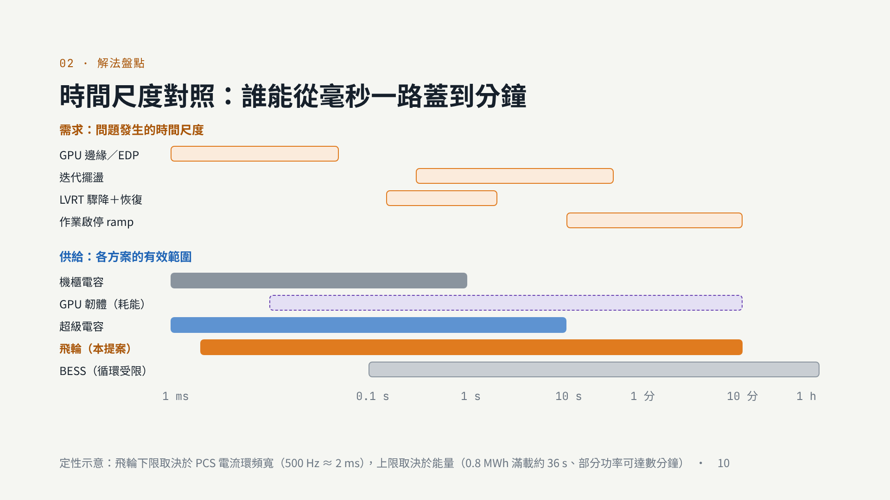

**講稿：**把需求和供給都放到同一條時間軸上。上面橘色是問題：GPU 邊緣和 EDP 尖峰在毫秒級，迭代擺盪在 0.3 到 30 秒，LVRT 驟降加恢復在 0.15 到 2 秒，作業啟停的 ramp 依限值從 10 秒到 10 分鐘。下面是方案：機櫃電容只蓋毫秒到 1 秒；超級電容蓋毫秒到 10 秒；BESS 從 0.1 秒到小時，但微循環會老化；GPU 韌體範圍很廣，但代價是燒電。飛輪從 2 毫秒一直蓋到十分鐘等級，剛好跟四個需求重疊，這就是我們選飛輪的核心理由。下限取決於 PCS 頻寬，上限取決於能量。

## 11. 針對兩個問題逐項比：飛輪是唯一四項都過的

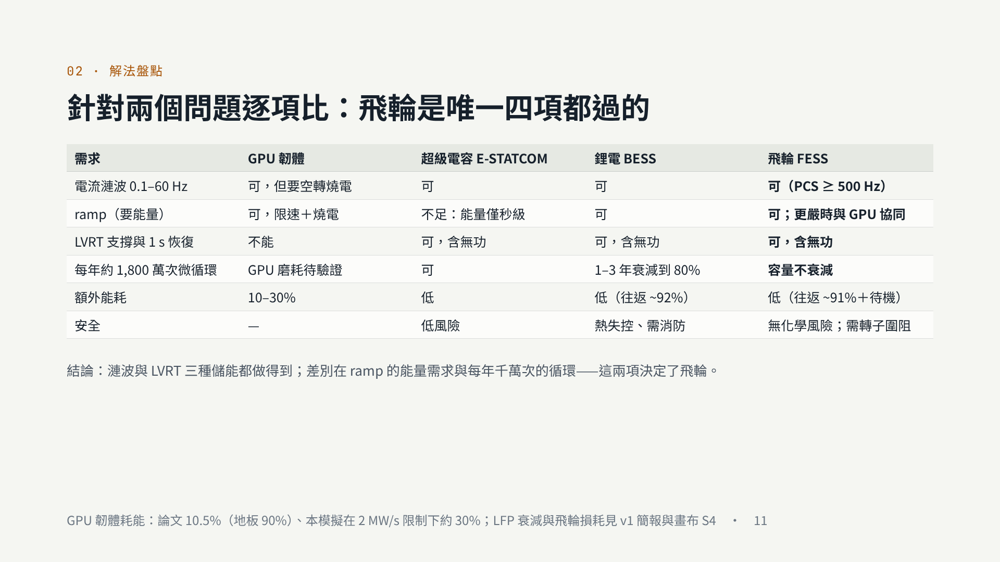

**講稿：**這張是決策表。把四個需求逐項比：電流漣波，只要電力電子頻寬夠，三種儲能都做得到，GPU 韌體也行但要燒電。ramp 需要能量，超級電容只有秒級，作業啟停那種幾十秒到幾分鐘的事件撐不住。LVRT 三種儲能都能做，含無功注入。真正分出勝負的是循環次數：每年大約 1,800 萬次微循環，鋰電一到三年就衰減到 80%，飛輪容量不衰減。所以結論很清楚：飛輪是唯一四項都過的方案，代價是待機損耗和轉子圍阻，這些我們在 v1 簡報已經量化過。

## 12. 系統架構：PCC 並聯的可控電流源

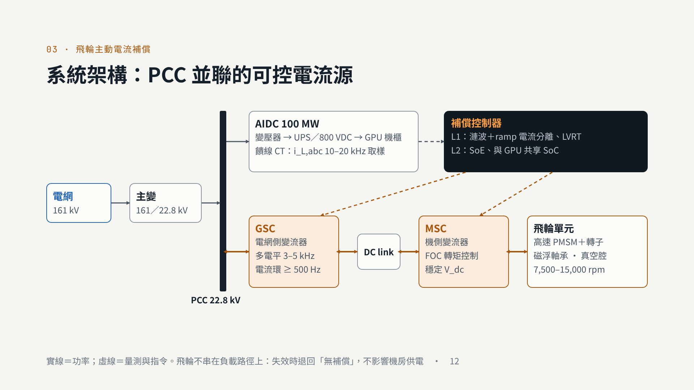

**講稿：**架構上，飛輪是並聯在 PCC 的一個可控電流源，不串在機房的供電路徑裡，所以飛輪失效時最壞就是退回無補償，不會讓機房斷電。功率路徑是背對背變流器：電網側的 GSC 負責注入我們要的電流，要求電流環頻寬 500 Hz 以上；中間是 DC link；機側的 MSC 用 FOC 控制飛輪馬達轉矩，任務是把 DC link 電壓穩住，等於把 GSC 吐出或吃進的能量轉成轉子動能。控制器的輸入是機房饋線 CT 的三相電流，10 到 20 kHz 取樣，L1 做電流分離和 LVRT 狀態機，L2 管 SoE，並且跟 GPU 韌體共享 SoC，這是論文建議的協同方式。

## 13. d 軸抵銷漣波與 ramp，q 軸做 LVRT，機側穩 V_dc

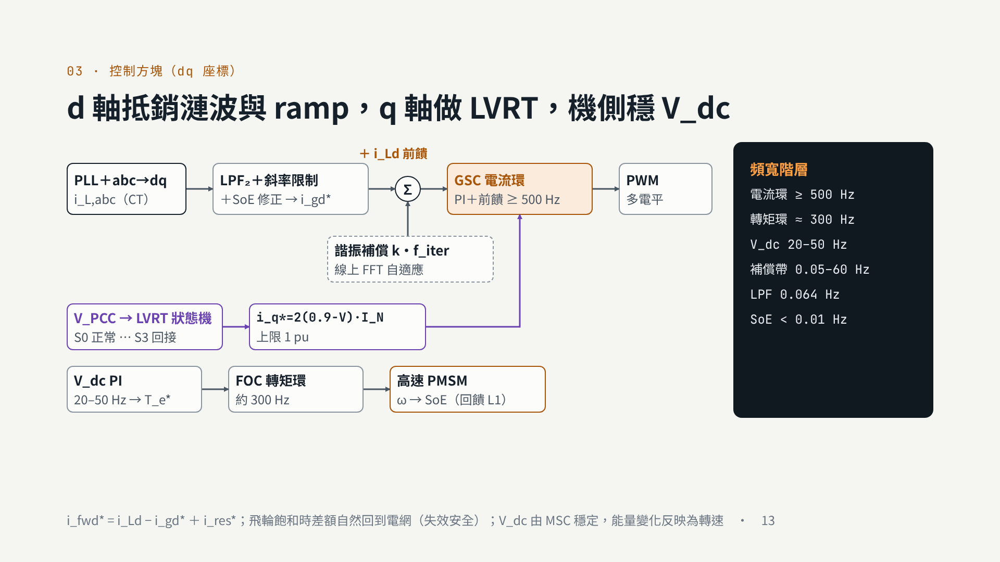

**講稿：**控制在 dq 座標下做。d 軸是有功：機房饋線電流經 PLL 轉到 dq，取出 i_Ld，經過二階低通、斜率限制和 SoE 修正得到電網應該看到的電流 i_gd*；飛輪的命令就是 i_Ld 減掉 i_gd*，這等於負載電流前饋，再加一組諧振補償器，鎖定迭代頻率的倍頻，迭代頻率會隨作業改變，所以用線上 FFT 自適應調整。q 軸是無功：LVRT 狀態機依電壓注入無功，照 2 倍斜率、上限 1 pu。機側的 MSC 用 V_dc 外環產生轉矩命令，FOC 轉矩環約 300 Hz，轉速回饋成 SoE。右邊是頻寬階層，關鍵是電流環要 500 Hz 以上，下一頁用模擬說明為什麼。

## 14. PCS 頻寬是成敗關鍵：100 Hz 不夠，要到 500 Hz

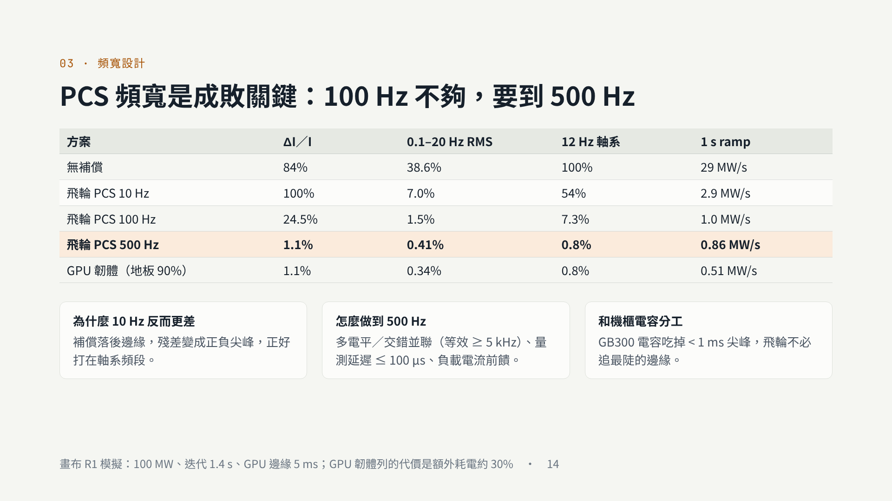

**講稿：**這張是我認為最重要的工程結論。我在模擬裡把 PCS 電流環頻寬當參數掃：10 Hz 的時候，電網電流的動態範圍反而比不補償還大，因為補償永遠慢半拍，殘差變成一正一負的尖峰，頻譜正好落在軸系扭振頻段，軸系響應還有 54%。100 Hz 好很多，但動態範圍還有 24%。到 500 Hz，動態範圍 1.1%，軸系響應 0.8%，跟 GPU 韌體平滑一樣好，但不用多燒 30% 的電。要在中壓做到 500 Hz，需要多電平或交錯並聯把等效開關頻率拉到 5 kHz 以上，量測延遲壓在 100 微秒內，加上負載電流前饋。另外可以和 GB300 的機櫃電容分工，毫秒以下的尖峰交給電容。這會是我們跟飛輪和 PCS 供應商談規格的第一條。

## 15. 四種模式，一套控制器同時守住 ramp 與 LVRT

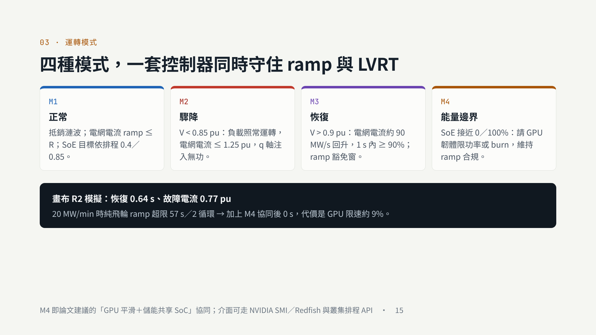

**講稿：**運轉模式分四種。M1 正常：抵銷漣波，電網電流的變化率壓在限值內，SoE 目標依排程器訊號調整，要開訓練前先充到 85%。M2 驟降：電壓掉到 0.85 以下，負載照常運轉不轉供，電網側電流限制在 1.25 倍以內，q 軸注入無功幫忙撐電壓。M3 恢復：電壓回到 0.9 以上，電網電流以每秒 90 MW 左右回升，1 秒內達到 90%，這段時間 ramp 豁免。M4 是能量邊界：飛輪快滿或快空的時候，請 GPU 韌體限功率或開 burner，這就是論文建議的共享 SoC 協同。模擬結果：恢復 0.64 秒、電流 0.77 pu；最嚴的每分鐘 20 MW 限值下，純飛輪會超限，加上 M4 就零超限，代價是 GPU 限速約 9%。

## 16. 功率看擺幅，能量看 ramp 限值

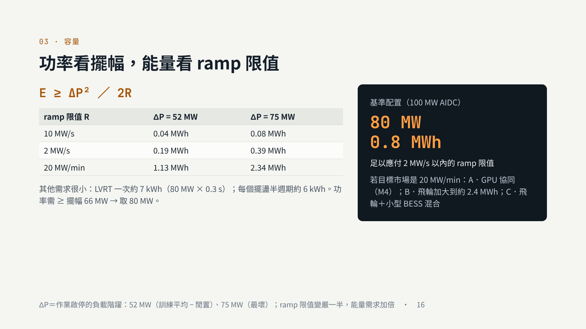

**講稿：**容量估算很直觀：功率看擺幅，能量看 ramp 限值。負載跳了 ΔP，電網只准每秒爬 R，中間那個三角形的面積就是飛輪要補的能量，ΔP 平方除以 2R。表上可以看到能量對 ramp 限值非常敏感：每秒 2 MW 只要 0.2 到 0.4 MWh，每分鐘 20 MW 就要 1.1 到 2.3 MWh。相比之下，LVRT 一次只要 7 度電，每個擺盪半週期 6 度電，都很小。所以基準配置 80 MW、0.8 MWh 足以應付每秒 2 MW 以內的市場；如果目標市場像 Southern Company 那麼嚴，有三條路：GPU 協同、飛輪加大、或飛輪加小型電池混合。這也是為什麼要盡早跟台電確認 ramp 限值。

## 17. 模擬結果：飛輪與 GPU 韌體一樣乾淨，但不燒電、還能穿越

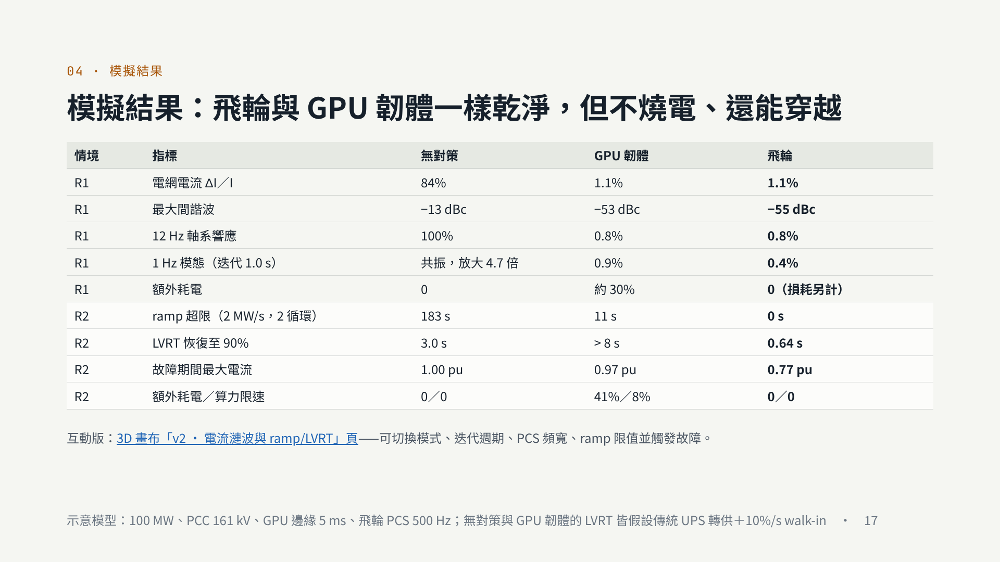

**講稿：**這是兩個 3D 情境的數字總表。上半是電流漣波：飛輪和 GPU 韌體平滑的效果幾乎一樣乾淨，間諧波都壓到 −50 dBc 以下，軸系響應 1% 以下；當迭代週期剛好 1 秒時，不補償會讓 1 Hz 模態放大 4.7 倍，兩種方法都能壓下來。差別在代價：GPU 韌體要多燒約 30% 的電，飛輪不用。下半是 ramp 和 LVRT：飛輪零超限、恢復 0.64 秒、電流 0.77 pu；GPU 韌體壓得住大部分 ramp，但遇到電壓驟降時還是要靠 UPS，恢復超過 8 秒，而且燒電 41%。這些都是示意模型，PoC 的第一步就是用真實波形校正。

## 18. 6 個月 PoC，先把頻寬與規範兩件事釘死

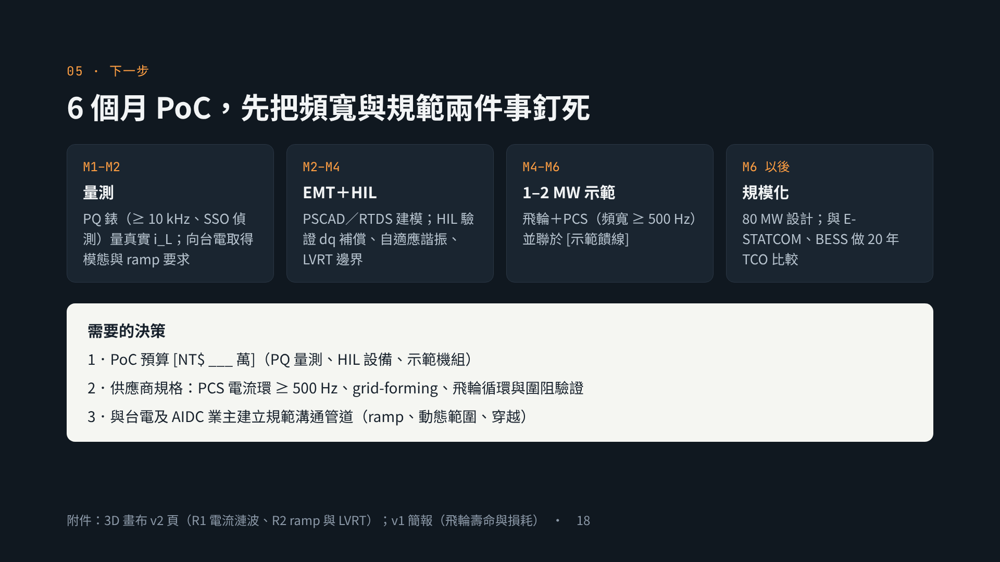

**講稿：**最後是下一步。PoC 六個月：前兩個月做量測，用支援次同步振盪偵測、10 kHz 以上取樣的 PQ 錶量真實的負載電流，同時去跟台電要系統模態和 ramp 的要求；第二到第四個月做 EMT 模型和 HIL，把 dq 補償、自適應諧振和 LVRT 邊界都驗過；第四到第六個月做 1 到 2 MW 的實機示範。需要您決定三件事：預算、供應商規格，尤其是 PCS 電流環 500 Hz 這條，以及跟台電、AIDC 業主建立規範溝通管道，這也是論文對電力公司的第一個呼籲。預算和示範饋線先留空，會後補。
